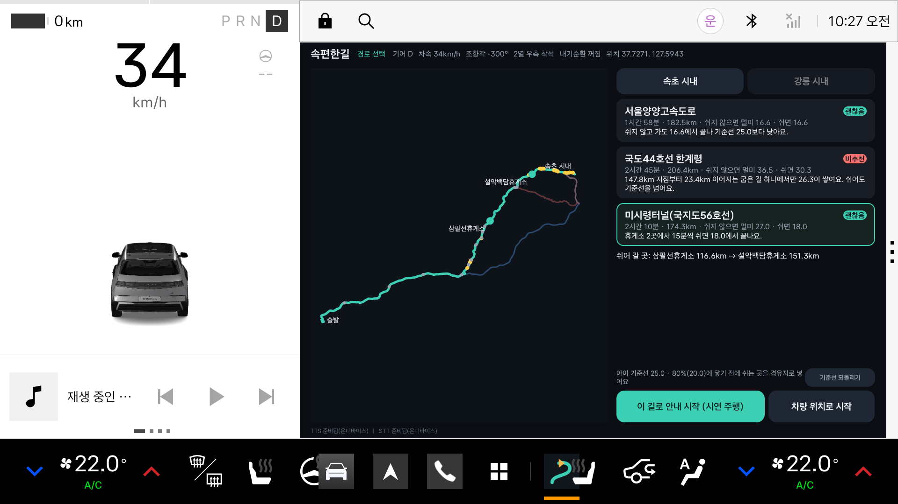
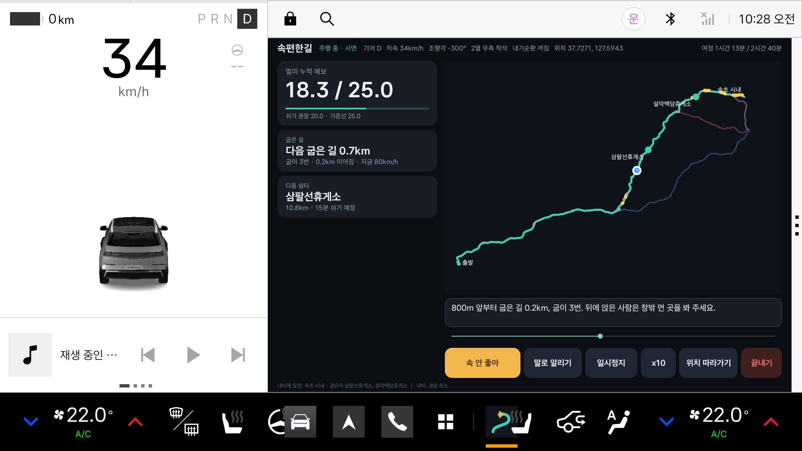
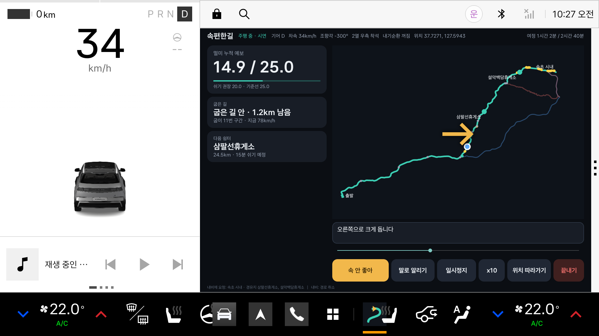
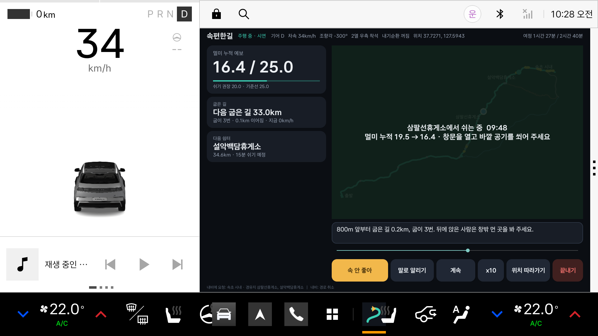
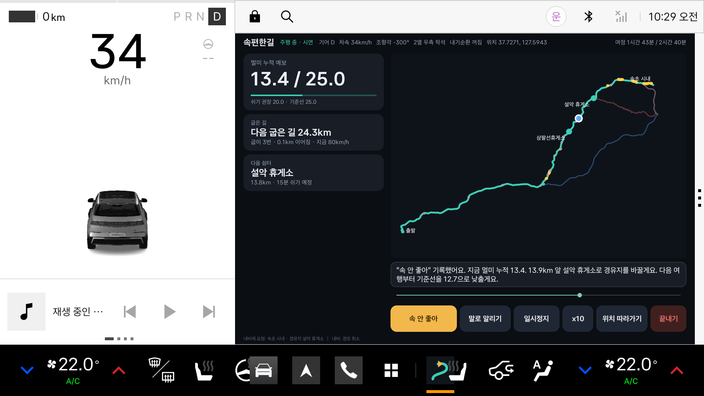
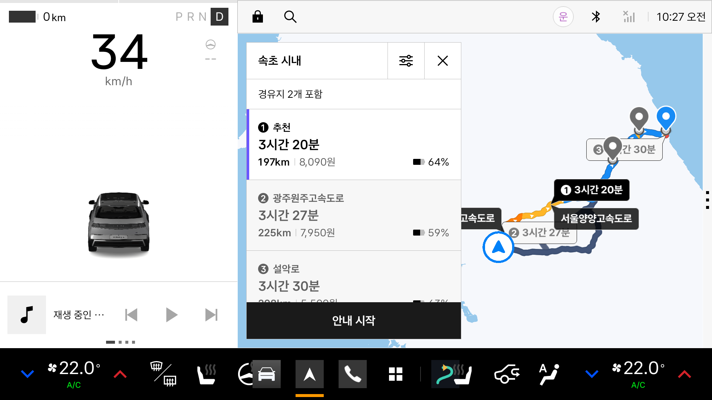

# 속편한길

가는 길에 굽은 길이 어디서 얼마나 이어지는지 미리 계산해서, 아이가 멀미하기 전에 쉴 휴게소를 내비 경유지로 넣고 굽이마다 소리로 먼저 알려 주는 Pleos Connect 차량용 앱입니다. "현대자동차그룹 차량용 앱 개발 공모전" 출품작의 동작하는 앱 버전입니다.



## 하는 일

| 기능 | 하는 일 | 쓰는 SDK |
|---|---|---|
| 경로별 멀미 예보 | 서울에서 속초·강릉 가는 경로 5개의 굽은 길 구간과 멀미 누적(MSDV)을 보여 준다. 쉬어도 기준선을 넘는 길은 "비추천"으로 표시한다 | 앱 안 데이터(`assets/routes.json`) |
| 휴게소 경유지 | 아이 기준선의 80%에 닿기 전 휴게소를 고르고, 내비에 목적지와 경유지 2곳을 넣는다 | NaviHelper `requestRouteWithWaypoints` |
| 굽이 알림 | 굽은 길 800m 전에 말로 알리고, 급한 굽이 직전에 좌우 화살표와 알림음을 낸다 | TextToSpeech (ON_DEVICE) |
| "속 안 좋아" 기록 | 말(또는 큰 버튼)로 알리면 그때 누적을 기록하고, 가까운 쉴 곳으로 경유지를 바꾸고, 다음 여행의 기준선을 낮춘다 | SpeechToText (ON_DEVICE), NaviHelper |
| 차량 값 | 기어, 조향각, 주행거리, 2열 우측 착석, 내기순환, 위치를 화면 위에 보여 주고, 위치를 경로에 맞춰 따라가는 모드가 있다 | Vehicle SDK, FusedLocation |
| 차속 | AAOS `PERF_VEHICLE_SPEED`를 읽는다. Vehicle SDK에는 차속 API가 없어서 반사로 호출한다 | android.car (CarPropertyManager) |

주행 화면은 멀미 누적 게이지, 다음 굽은 길, 다음 쉼터 세 가지만 크게 보여 줍니다.







## 실행 방법

### APK로 설치

`apk/sokpyeon_SokpyeonRoad_release.apk`를 Pleos Connect Emulator(아래)에 설치합니다.

```bash
adb install apk/sokpyeon_SokpyeonRoad_release.apk
adb shell am start -n app.sokpyeon.road/.ui.MainActivity
```

처음 켜면 권한 창이 세 번 뜹니다(마이크, 위치 `FUSED_LOCATION`, 차속 `CAR_SPEED`). 모두 허용합니다. 차량 앱은 보조 사용자(user 10)로 돌기 때문에 adb로 미리 허용하려면 `adb shell pm grant --user 10 app.sokpyeon.road <권한>`을 씁니다.

### 소스에서 빌드

JDK 17 이상(21에서 확인)과 Android SDK 34가 필요합니다. Gradle은 래퍼가 내려받습니다.

```bash
export ANDROID_SDK_ROOT=<Android SDK 경로>
./gradlew :app:testDebugUnitTest      # 휴식 계획·멀미 누적 계산 시험 7개
./gradlew :app:assembleDebug          # app/build/outputs/apk/debug/app-debug.apk
```

release 서명은 저장소 밖의 서명 정보 파일을 환경변수로 가리킵니다. 파일 형식은 `storeFile`, `storePassword`, `keyAlias`, `keyPassword` 네 줄입니다. 환경변수가 없으면 서명 없이 빌드됩니다.

```bash
SOK_KEYSTORE_PROPS=<서명 정보 파일 경로> ./gradlew :app:assembleRelease
```

Pleos SDK(Vehicle 2.3.2, NaviHelper 3.0.5, FusedLocation 1.1.3, TextToSpeech·SpeechToText 3.3.1)는 `settings.gradle.kts`에 등록한 Pleos Maven 저장소에서 받습니다. SDK 파일은 이 저장소에 넣지 않았습니다.

## 테스트 환경과 필요한 설정

- Pleos Connect Emulator 2.1.0(Android 14, API 34, Automotive). 맥(arm64)용 이미지를 썼습니다.
  - SDK Manager의 Update Site에 `https://nexus-playground.pleos.ai/repository/raw-releases/connect-avd/2.x/crp-arm64-sys-img.xml`을 추가하고 이미지를 받습니다. 이미지를 쓰려면 42dot SDK 라이선스에 동의해야 합니다.
  - AVD 설정: RAM 4GB, Cold boot(Quick boot에서는 차량 서비스가 안 뜹니다).
- 화면 규격: Automotive 1080p landscape, 1920x1080, 160dpi. 앱이 쓰는 영역은 계기판과 하단 바를 뺀 가로 약 1280dp, 세로 약 850dp입니다. 다른 해상도에서는 확인하지 못했습니다.
- minSdk 28, targetSdk 34, Kotlin 2.0.0, AGP 8.8.2, Gradle 8.10.2.
- Virtual Console로 차량 값을 바꿔 가며 시험합니다. 에뮬레이터를 켠 뒤 `adb forward tcp:8088 tcp:8088`을 하고 브라우저에서 `http://127.0.0.1:8088/`을 엽니다.
  - 기어 D, 조향각, 가속 페달을 조작하면 앱 윗줄의 기어·조향각·차속이 바뀝니다.
- 위치는 `adb emu geo fix <경도> <위도>`로 넣을 수 있습니다. 앱에서 "차량 위치로 시작"을 누르면 그 위치를 경로 위에 맞춰 따라갑니다.

## 화면 조작

- 출발 전: 속초·강릉을 고르고 경로 카드를 눌러 비교합니다. "이 길로 안내 시작"을 누르면 내비에 목적지와 휴게소 경유지가 들어가고 주행 화면으로 넘어갑니다.
- 주행 화면(시연 주행): 에뮬레이터에서는 차가 실제로 달리지 않아서 앱이 경로 위를 x10~x120배속으로 달립니다. 아래 막대로 여정 위치를 옮길 수 있습니다.
- "속 안 좋아" 버튼은 말로 알리는 것과 같은 기록을 남깁니다. 달리는 중에 기록하면 다음 여행의 기준선이 낮아지고, "기준선 되돌리기"로 25로 되돌립니다.

## 확인한 것과 못 한 것

Pleos Connect Emulator 2.1.0에서 직접 확인했습니다.

- Vehicle SDK: 기어, 조향각, 주행거리, 2열 우측 착석, 내기순환 조회와 변화 알림. Virtual Console에서 바꾼 값이 앱에 들어옴
- 차속: AAOS `PERF_VEHICLE_SPEED`를 읽음(Virtual Console에서 가속하면 값이 올라감)
- FusedLocation: `adb emu geo fix`로 넣은 위치를 받아 경로 위에 표시
- NaviHelper: 목적지와 경유지 2곳을 요청하면 차량 내비가 "경유지 2개 포함" 경로를 띄움. "속 안 좋아" 뒤에는 경유지를 바꿔 다시 요청함
- TextToSpeech(ON_DEVICE): 안내 문장이 재생됨(onStart, onDone 확인)
- SpeechToText(ON_DEVICE): 요청이 온디바이스 엔진에 닿고 한국어로 인식을 시작함

확인하지 못한 것도 있습니다.

- 음성 인식 결과를 마이크로 받는 시험은 못 했습니다. 시험한 맥에 마이크가 없어서, 앱 내부 폴더의 `files/stt_test.pcm`(16kHz, 모노, 16비트)이 있으면 그 소리를 `sendAudio`로 보내 보는 개발용 경로를 넣었고, 이 경로에서 SDK 로그에 "너는 속이 안 좋" 같은 부분 인식이 찍히는 것까지 봤습니다. 실제 마이크 입력의 인식률은 확인하지 못했습니다.
- 차량 내비의 길 안내 자체는 Pleos 내비가 하는 일이라, 앱은 경유지를 넣는 데까지만 합니다.
- 실차에서는 시험하지 않았습니다.

## 계산 방법

경로별 굽은 길과 멀미 누적은 앱 밖에서 미리 계산해 `app/src/main/assets/routes.json`에 넣었습니다(`tools/make_assets.py`는 계산 결과에서 앱이 쓰는 값만 뽑는 스크립트). 누적은 좌우 가속도를 ISO 2631-1 Wf 가중으로 걸러 제곱합한 멀미 선량이고, 휴식 중에는 15분 시간상수로 줄어듭니다. 아이 기준선은 처음 25, 휴게소는 기준선 80%에 닿기 전에 20분 이상 간격으로 고릅니다. 앱 안의 `core/Planner.kt`가 같은 규칙으로 휴식 계획을 다시 계산하고, `app/src/test`의 시험이 분석 결과(한계령 길은 기준선을 넘고, 미시령터널 길은 휴게소 2곳이면 27.0에서 18.0으로 끝남)와 맞는지 확인합니다.

## 데이터 출처

`docs/DATA.md`를 봅니다. 도로 선형은 국가교통정보센터 국가표준노드링크, 휴게소 위치는 OpenStreetMap 기여자(ODbL)와 한국도로공사 자료입니다.

## 폴더

- `app/src/main/java/app/sokpyeon/road/core`: 경로 자료, 휴식 계획, 여정 시간표, 음성 안내 규칙(안드로이드와 무관한 코드)
- `app/src/main/java/app/sokpyeon/road/car`: Pleos SDK 연결(Vehicle·FusedLocation, NaviHelper, TTS·STT)
- `app/src/main/java/app/sokpyeon/road/ui`: 화면
- `apk/`: release APK
- `docs/`: 화면 캡처, 데이터 출처

## 라이선스

아직 정하지 않았습니다. 공모전 심사용으로 공개합니다.
